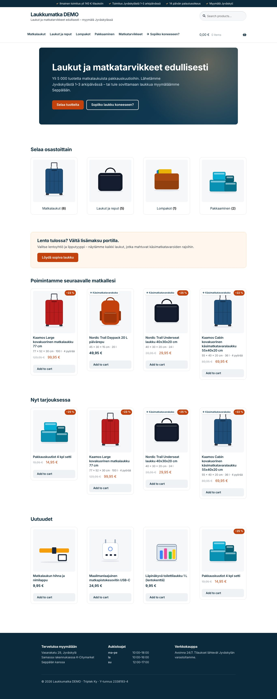
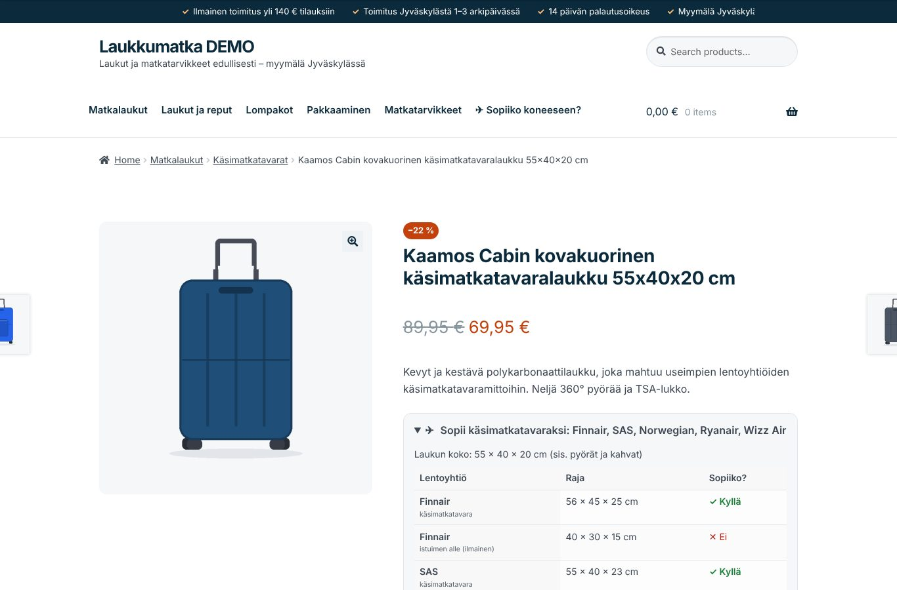
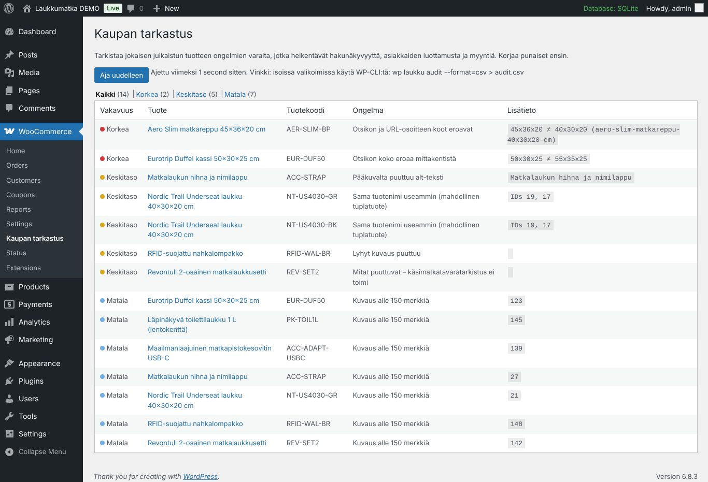
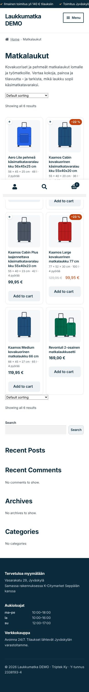

# Laukkumatka WooCommerce demo

A WordPress/WooCommerce project I built to prepare for the work trial at **Triptek Ky / laukkumatka.fi**.
It is a small, working luggage store with the kinds of front-end, usability and SEO improvements I would like to bring to the real shop.

> Demo only: brands, products and prices are made up. Store details (address, opening hours, business ID) are copied from the public laukkumatka.fi footer.



## What's inside

| Part | What it is | Why it matters for a luggage store |
|---|---|---|
| **`laukku-storefront-child`** (theme) | Child theme of WooCommerce's official Storefront theme | Clearer product cards, trust signals, a cleaner buy box, mobile and accessibility fixes. All changes use hooks, so Storefront updates stay safe. |
| **`laukku-travel-tools`** (plugin) | A custom WooCommerce plugin | Luggage data fields, an airline cabin-size checker, a "will it fit?" finder, a free-shipping progress bar, richer Google structured data, and a catalogue audit tool |
| **`bin/setup-store.php`** | Setup script run with WP-CLI | Sets up a Finnish store in seconds: EUR, 25.5 % VAT, a shipping zone with free delivery over 140 €, store pickup, categories, 16 products, pages and a menu |
| **`docs/STORE-AUDIT.md`** | Review of the live laukkumatka.fi | A ranked list of problems I found and fixes I'd suggest. This is the "test the store and propose improvements" task. |
| **`docs/DEMO-SCRIPT.md`** | 5-minute walkthrough | What to show, in what order |

## Features in detail

### 1. "Will it fit on the plane?" – cabin-size checker
The most common question a luggage shopper has. Every bag with dimensions gets:

- **On the product page:** a panel listing which airlines accept the bag as cabin luggage, plus a table comparing it with each airline's size limit. The check allows the bag to be rotated, the same way it fits in an airline's sizer.
- **On product cards:** a ✈ *Käsimatkatavarakoko* (cabin size) badge.
- **On a finder page** (`[laukku_cabin_finder]`): pick an airline and ticket type, or type your own size limit, and see every bag that fits. It is a plain GET form, so it works without JavaScript and results can be shared as a link, e.g. `?lentoyhtio=ryanair_free`.
- Fit results are calculated when a product is saved and stored as post meta, so the finder runs one cheap query instead of looping over 5,000 products.
- The airline list can be changed through the `laukku_tt_airlines` filter. **The airline limits are example values. Check them before using this in production.**



### 2. Free-shipping progress bar
"Lisää ostoskoriin vielä 23,10 €, niin toimitus on ilmainen!" It appears in the cart, mini-cart and checkout, and works with both the classic and the block-based cart.
The threshold is **read from WooCommerce's own Free shipping method**, so the banner and the checkout always show the same amount.

### 3. Luggage product data
A **Laukku** tab in the product editor with volume (litres), wheels, shell type and warranty. Dimensions reuse WooCommerce's built-in shipping fields, so they are stored in one place only.
Product cards show a spec line, for example `55 × 40 × 20 cm · 36 l · 4 pyörää`. The extra fields also appear in the *Tekniset tiedot* (specifications) tab.

### 4. SEO: structured data
- **Product** markup is extended with brand, dimensions, weight, volume and a `MerchantReturnPolicy` (14-day return right) for Google rich results.
- **Store** (LocalBusiness) markup with the address and opening hours, which helps local searches like "laukkukauppa Jyväskylä".
- Categories get real descriptions, and permalinks use Finnish slugs (`/tuote/…`, `/tuoteosasto/…`).

### 5. Store audit (admin page + WP-CLI)
**WooCommerce → Kaupan tarkastus** (Store audit) checks every product for problems that hurt SEO and trust. Most of these came from issues I saw on the live site:

| Check | Severity |
|---|---|
| Size in the title doesn't match the URL slug (e.g. title *45x36x20*, slug *40x30x20*) | High |
| Size in the title doesn't match the dimension fields | High |
| Missing price, or a sale price that isn't lower than the regular price | High |
| Duplicate product titles (possible duplicate listings) | Medium |
| Missing image alt text, short description or dimensions | Medium |
| Thin description, title over 70 characters, uncategorized | Low |

```bash
wp laukku audit                       # table
wp laukku audit --severity=high
wp laukku audit --format=csv > audit.csv
wp laukku cabin-sync                  # recalculate cabin fit after bulk imports
wp laukku fits 55x40x23               # quick check from the terminal
```

**Seeded issues:** the sample data contains 6 intentional problems so the audit has something to find, including a size mismatch in a URL (the same kind of issue the live store has), a duplicate listing and a missing alt text.



### 6. Theme / UX changes
- **Trust bar** at the top: free delivery over 140 €, 1–3 day shipping from Jyväskylä, 14-day returns, shop in Seppälä
- **Sale badge shows the saving** (−22 %) instead of "Sale!"
- **Reassurance list under the Add to cart button** (delivery, returns, pick-up in store)
- **Full-width product, cart and checkout pages**: no sidebar where people make the buying decision
- **Large −/+ quantity buttons**, 44 px touch targets (WCAG 2.5.8)
- **Two-column product grid on phones**, and the cabin badge becomes an icon on narrow cards
- **Visible keyboard focus** everywhere; the accent colour has AA contrast (4.9:1)
- **System font stack**: Storefront's Google Fonts request is removed, which is faster and avoids sending visitors' IP addresses to a third party (GDPR)
- **Footer** with the shop address, opening hours and a copyright year that updates automatically (the live site still shows 2024)
- **Homepage** in this order: hero → categories → "Will it fit?" teaser → picks → sale → new arrivals



### 7. Finnish translations
All strings are written in English in the code and translated to Finnish (`.po`/`.mo`) with the standard WordPress workflow:
`wp i18n make-pot` → `tools/build_translations.py`. The store runs in Finnish, and the code is ready for other languages.

## Run it locally

Requirements: Docker Desktop.

```bash
docker compose up -d
docker compose run --rm cli bash /project/bin/setup.sh
```

Open **http://localhost:8080**. Admin: **http://localhost:8080/wp-admin** (user `admin`, password `admin`).

The theme and plugin folders are mounted into the container, so you can edit files and refresh the browser. Remove everything with `docker compose down -v`.

**Without Docker** (an existing WordPress with WP-CLI): copy the two folders from `wp-content/` into your site, then run `bash /path/to/project/bin/setup.sh /path/to/project` from the WordPress root.

## Code quality notes
- Coding standards: WordPress Coding Standards (`phpcs.xml.dist`). The code passes with no errors or warnings.
- Data is saved through WooCommerce CRUD (`WC_Product::update_meta_data`), not raw SQL.
- The plugin declares compatibility with **HPOS** (High-Performance Order Storage) and the block-based Cart & Checkout.
- Security: nonce and capability checks on admin actions; all output is escaped and all input is sanitised.
- Everything can be extended through filters: `laukku_tt_airlines`, `laukku_tt_free_shipping_threshold`, `laukku_tt_shell_options`, `laukku_child_trust_items`, `laukku_child_store_info`.
- Tested on WordPress 6.8, WooCommerce 10.3, Storefront 4.6 and PHP 8.3.

## Known limitations / next steps
- On the **block** cart, the shipping bar is rendered on the server. It updates when the page reloads, but not instantly when the quantity changes. The next step would be a small Store API / `wc-blocks` integration.
- The finder's custom-size search checks at most 500 products per request. For the full 5,000+ catalogue I would pre-compute fit data into a custom lookup table.
- Variable products (one product with colour variations) would fix the duplicate-listing problem properly. That is the main data clean-up I would suggest for the real store.

## Project structure
```
├── bin/
│   ├── setup.sh               # one-command setup (WP-CLI)
│   └── setup-store.php        # Finnish store config + sample data
├── docker-compose.yml
├── docs/
│   ├── STORE-AUDIT.md         # review of the live laukkumatka.fi
│   ├── DEMO-SCRIPT.md
│   └── screenshots/
├── sample-data/
│   ├── products.json          # 8 categories, 16 products
│   └── images/
├── tools/
│   ├── build_translations.py
│   └── generate_product_images.py
└── wp-content/
    ├── plugins/laukku-travel-tools/
    └── themes/laukku-storefront-child/
```

---
Oba Oriekwo · obaoriekwo@gmail.com
